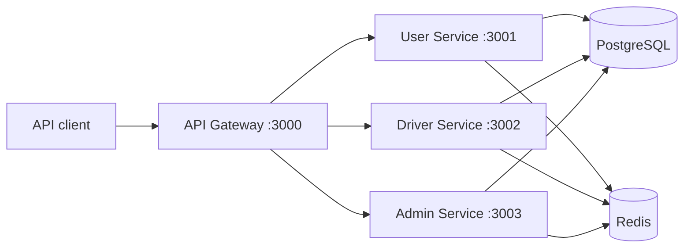

# LogiConnect

LogiConnect is an API-first logistics platform for matching users, vehicles, and drivers and managing a delivery booking lifecycle.


## Architecture



| Service | Description | Port | Reference | Interactive API |
| --- | --- | ---: | --- | --- |
| API Gateway | Routes external requests to the backend services | 3000 | [Gateway docs](api-gateway/DOCS.md) | [Swagger](http://localhost:3000/docs) |
| User Service | User accounts, vehicle search, and bookings | 3001 | [User docs](user-service/DOCS.md) | [Swagger](http://localhost:3001/docs) |
| Driver Service | Driver authentication, profiles, and booking workflow | 3002 | [Driver docs](driver-service/DOCS.md) | [Swagger](http://localhost:3002/docs) |
| Admin Service | Admin authentication and fleet management | 3003 | [Admin docs](admin-service/DOCS.md) | [Swagger](http://localhost:3003/docs) |

## Run locally with Docker

Prerequisites: Docker with Compose and GNU Make.

```bash
make setup
# Add a Google Maps API key to .env for geocoding and booking calculations.
make start
```

The gateway is available at `http://localhost:3000`. Individual services remain exposed for their Swagger and ReDoc pages. Stop everything with `make stop`.

If a default host port is already occupied, change the corresponding `*_HOST_PORT` value in `.env`; container-to-container ports do not change.

The generated `.env` is development-only and is ignored by Git. Change its sample credentials before using the project outside a local machine.

## Run a service natively

Start PostgreSQL and Redis, create a virtual environment, install the selected service's requirements, and export the variables listed in its `DOCS.md`. Use a host-accessible database URL and Redis host rather than the container names from `.env.example`.

```bash
python3.12 -m venv .venv
source .venv/bin/activate
pip install -r user-service/requirements.txt
cd user-service
uvicorn main:app --reload --port 3001
```

## Authentication

Login endpoints return a bearer token. Supply it to protected endpoints as:

```http
Authorization: Bearer <access-token>
```

The gateway forwards authorization and content headers to the appropriate service. See each service reference for the required query parameters and request bodies.

## Tests and builds

Install the test dependencies in the same environment as a service before running its suite:

```bash
pip install -r user-service/requirements.txt -r requirements-test.txt
python -m pytest user-service/tests
```

`make test` runs all four suites when all service dependencies are installed. `make docker-build` builds every image and `make config` validates the Compose configuration.

GitHub Actions exposes separate checks for every service under `Test / <service>` and `CI / docker-build / <service>`.

## Roadmap

- Establish reproducible load-test scenarios and publish measured throughput and latency.
- Add Kubernetes manifests and production-focused observability.
- Add database-backed integration tests and migration management.

Scalability figures are intentionally not claimed until repeatable benchmark results are available.
